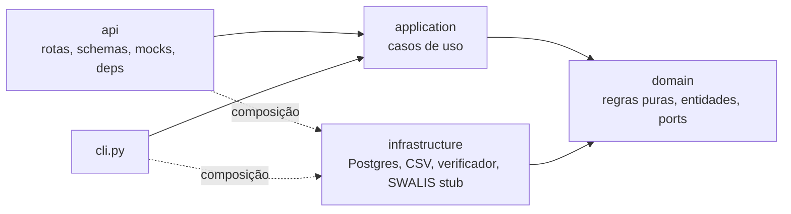
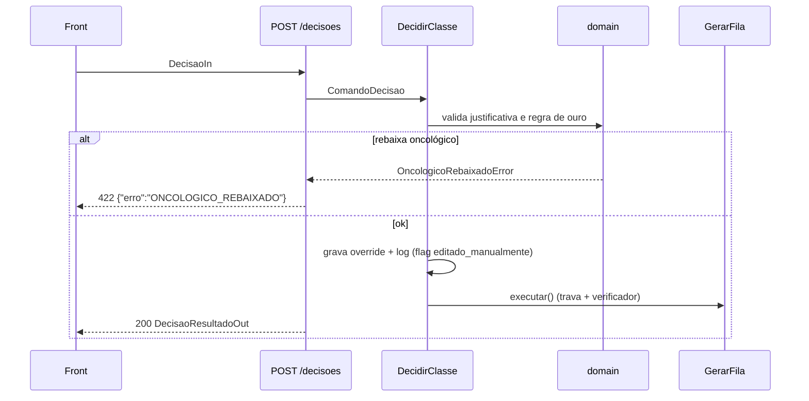

# Arquitetura do backend — HealthPrior

> **Status:** v1 · 24/10/2026 · decisão D-14
> **Para quem:** agentes de IA e pessoas que vão escrever código no `backend/`.
> **Relacionados:** `docs/fluxo-sistema.md` (o que o sistema faz), `docs/user-stories.md` (o que construir e contrato da API), `backend/AGENTS.md` (comandos e resumo).

---

## 1. Princípios

1. **Clean Architecture enxuta.** Quatro camadas com dependência em um só sentido. Nada além disso.
2. **Regra clínica separada de detalhe técnico.** A regra de ouro, o CID e as regras PRE-xx vivem no domínio, em Python puro, testáveis sem banco nem servidor.
3. **Trocar peças sem efeito colateral.** O SWALIS provisório vira o real, o mock vira o caso de uso, o banco vira outro: tudo trocando só a composição (`api/deps.py`, `cli.py`).
4. **Hackathon.** Sem framework de DI, sem repositório genérico, sem DTO duplicado, sem camadas "para o futuro". O que não é negociável é a **regra de dependência** e as **invariantes** de `docs/fluxo-sistema.md` §9.

---

## 2. Camadas e regra de dependência



| Camada | Pode importar | Não pode importar |
|---|---|---|
| `domain/` | biblioteca padrão | `application`, `infrastructure`, `api`, `fastapi`, `sqlmodel`, `pandas` |
| `application/` | `domain` | `infrastructure`, `api`, `fastapi`, `sqlmodel` |
| `infrastructure/` | `domain`, libs técnicas (sqlmodel, pandas) | `api`, `application` |
| `api/` | tudo (é a borda) | — |

**Guardião automático:** `backend/tests/test_arquitetura.py` analisa os imports e falha se a regra for quebrada. Rode `pytest -q` antes de commitar.

**Por que assim:** o domínio carrega as invariantes que desclassificam o time se violadas. Mantê-lo puro permite testar a regra de ouro com 3 linhas de teste e garante que nenhuma mudança de banco/API altere a ordem da fila sem um teste de domínio falhar.

---

## 3. Estrutura de pastas

```
backend/
  AGENTS.md / CLAUDE.md      instruções locais para agentes
  requirements.txt           dependências
  pyproject.toml             config de pytest/ruff
  app/
    config.py                settings (REF_DATE=2026-10-23, caminhos, HP_USE_MOCKS)
    main.py                  create_app(): CORS, handlers de erro, routers, /health
    cli.py                   init-db, carga, gerar-fila, decisoes
    domain/
      enums.py               Camada, Classe (+ PRAZO_MAXIMO_DIAS), StatusFila, MotivoCodificado…
      models.py              Solicitacao, Evento, Motivo, ResultadoScore, Achado, Correcao,
                             Pendencia, Decisao, ItemRanking, ItemFila
      errors.py              DomainError e subclasses (código + status HTTP)
      ports.py               Protocols: repositórios, SwalisScorer, VerificadorFila
      cid.py                 normalizar_cid, is_oncologico, is_lesao_incerta, is_cid_urgente
      urgencia.py            sinais de urgência (camada 2), palavras de alarme
      ranking.py             trava da regra de ouro: definir_camada, ordenar_fila (US-08)
      preprocessing/
        normalizacao.py      PRE-01..04 (US-02)
        municipios.py        nomes oficiais dos 38 municípios do dataset (PRE-03, D-19)
        flags.py             PRE-05..08 (US-03)
        inconsistencias.py   PRE-10..25 (US-04, US-05)
    application/
      carga_inicial.py       US-01 (+ normalização, mesma transação)
      normalizar.py          US-02
      gerar_fila.py          US-08/09/10
      registrar_evento.py    US-15
      decidir.py             US-13/14
      resolver_pendencia.py  US-07
    infrastructure/
      db.py                  engine, criar_tabelas, get_session
      tables.py              tabelas SQLModel (espelham fluxo-sistema.md §8)
      repositories.py        Sql*Repository: Table <-> entidade
      csv_loader.py          LeitorDataset (CSV tipado, só leitura de data/)
      swalis_stub.py         SwalisStub (placeholder do contrato C-07)
      verificador.py         VerificadorOficial (subprocess do verificador)
      exportador.py          ExportadorCsv (fila_priorizada.csv)
    api/
      schemas.py             contrato da API (= docs/user-stories.md §5)
      mocks.py               respostas fixas com o contrato final
      deps.py                composição: instancia implementações concretas
      errors.py              DomainError -> {"erro","mensagem"}; NotImplementedError -> 501
      routers/               fila, solicitacoes, inbox, decisoes, eventos, pendencias, admin
  tests/
    test_arquitetura.py      regra de dependência
    domain/                  testes de regra pura (casos reais do dataset)
    application/             casos de uso e stubs
    api/                     contrato dos endpoints
```

---

## 4. Responsabilidade de cada camada

### 4.1 `domain/` — o coração
- **Entidades** são `dataclasses` simples, com nomes de campos do dataset e de `fluxo-sistema.md` §8.
- **Regras** são funções puras: mesma entrada, mesma saída; sem I/O; sem `date.today()` (datas chegam de fora, a partir de `settings.ref_date`).
- **Ports** (`ports.py`) são `Protocol`s que descrevem o que a aplicação precisa do mundo externo (persistência, SWALIS, verificador). O domínio define a interface; a infraestrutura implementa.
- **Erros** de regra são `DomainError` com `codigo` e `status_http`. Ex.: `OncologicoRebaixadoError` (I-01) → `422 ONCOLOGICO_REBAIXADO`.

### 4.2 `application/` — os fluxos
- Um arquivo por caso de uso, uma classe com `executar(...)`.
- Recebe as **portas no construtor** (injeção manual) e orquestra: buscar → aplicar regras do domínio → salvar → (gerar fila → verificar → publicar).
- Não sabe qual é o banco nem se a chamada veio da API ou da CLI.

### 4.3 `infrastructure/` — os detalhes
- Implementa as portas. Converte `Table` ↔ entidade nos repositórios.
- **Pandas fica aqui** (leitura e processamento em lote do dataset).
- `swalis_stub.py` é **provisório e não é regra clínica**: classe pela prioridade normalizada (oncológico = A2), score = % do prazo. Existe para destravar a trava, a entrega e o front.

### 4.4 `api/` — a borda HTTP
- Rotas **finas**: validam entrada (Pydantic), chamam um caso de uso, devolvem um schema. **Nenhum `if` de regra de negócio em rota.**
- `schemas.py` **é** o contrato do front. O OpenAPI (`/openapi.json`) gera os tipos TypeScript.
- `mocks.py` responde com o contrato final enquanto `HP_USE_MOCKS=true` (padrão), para o front trabalhar em paralelo.
- `deps.py` é o **único lugar** (junto com `cli.py`) que instancia classes concretas.

---

## 5. Fluxos ponta a ponta

### 5.1 Gerar e publicar a fila (US-08/09/10)

```mermaid
sequenceDiagram
    participant CLI as cli / rota
    participant UC as GerarFila (application)
    participant REP as Sql*Repository (infra)
    participant SW as SwalisScorer (infra)
    participant RK as ranking (domain)
    participant EXP as ExportadorCsv (infra)
    participant VER as VerificadorOficial (infra)
    CLI->>UC: executar()
    UC->>REP: listar ativas + eventos
    loop cada solicitação
        UC->>SW: calcular(solicitacao, eventos)
    end
    UC->>RK: ordenar_fila(itens)  [camadas, I-01]
    UC->>EXP: exportar(linhas, output/fila_priorizada.csv)
    UC->>VER: verificar(csv)
    alt passou
        UC->>REP: salvar_publicada(...)
    else falhou
        UC-->>CLI: não publica; mantém anterior (I-07)
    end
```

### 5.2 Decisão do regulador (US-13/14)



---

## 6. Receitas (como adicionar coisas)

### Nova regra de pré-processamento (ex.: PRE-26)
1. Função pura em `domain/preprocessing/<arquivo>.py` que recebe entidades e devolve `Achado`/`Correcao`.
2. Teste em `tests/domain/` com um **ID real** do dataset.
3. Chamar a função no caso de uso que pré-processa (`carga_inicial.py` / `registrar_evento.py`).
4. Documentar a regra na tabela de `docs/fluxo-sistema.md` C-05.

### Novo endpoint
1. Schemas em `api/schemas.py` (e na §5 de `docs/user-stories.md`, no mesmo PR).
2. Rota em `api/routers/<recurso>.py`, registrada em `main.py`.
3. Se houver regra: caso de uso em `application/`, montado em `api/deps.py`.
4. Teste em `tests/api/`.

### Trocar o SWALIS stub pelo real
1. Implementar uma classe com `versao_regras` e `calcular(solicitacao, eventos) -> ResultadoScore` (Protocol `SwalisScorer`).
2. Trocar `get_scorer()` em `api/deps.py` e o equivalente em `cli.py`. Nada mais muda.

### Trocar mock por implementação real
1. Implementar o caso de uso.
2. Na rota, substituir o `raise NotImplementedError` pela chamada ao caso de uso via `Depends`.
3. Manter o mesmo `response_model`. Rodar com `HP_USE_MOCKS=false`.

### Novo repositório
1. Declarar o `Protocol` em `domain/ports.py` só com os métodos que alguém usa.
2. Implementar `Sql...Repository` em `infrastructure/repositories.py`.

---

## 7. Convenções de código

- Código em inglês ou português? **Nomes do domínio em português** (são os termos do dataset e do fluxo: `solicitacao`, `camada`, `pendencia`); termos técnicos genéricos podem ficar em inglês. Comentários e docstrings em português.
- Type hints em tudo; `from __future__ import annotations` nos módulos de domínio/aplicação.
- Funções pequenas, um propósito; nomes que dizem a regra (`is_oncologico`, `ordenar_fila`).
- Pendências do backlog marcadas como `TODO(US-xx)`; `grep -rn "TODO(US-" backend/app` lista o que falta.
- `NotImplementedError("US-xx: ...")` em código ainda não feito (a API devolve 501, deixando explícito).
- Nada de `print` em código de aplicação; a CLI é o único lugar que imprime.

## 8. Testes

| Tipo | Onde | O que garante |
|---|---|---|
| Arquitetura | `tests/test_arquitetura.py` | regra de dependência |
| Domínio | `tests/domain/` | regras PRE-xx, CID, trava (I-01) com IDs reais |
| Aplicação | `tests/application/` | orquestração com fakes/stubs |
| API | `tests/api/` | contrato dos endpoints (formato da §5) |
| Entrega | `src/verificar_fila_priorizada.py` | regra de ouro no CSV final |

Mínimo antes de commitar: `cd backend && pytest -q`. Se mexeu em ordenação/classe/status: gerar a fila e rodar o verificador (`/verificar-fila` no Claude Code).

## 9. Checklist para agentes de IA

- [ ] A mudança está na camada certa (seção 6)?
- [ ] O domínio continua sem `fastapi`, `sqlmodel`, `pandas`, I/O e `date.today()`?
- [ ] A rota continua sem regra de negócio?
- [ ] O schema da API mudou? Então `docs/user-stories.md` §5 mudou no mesmo commit.
- [ ] Há teste com ID real do dataset?
- [ ] `pytest -q` passou (inclui o teste de arquitetura)?
- [ ] Se tocou ordenação/classe/status: verificador OK e revisão do `guardiao-invariantes`?
