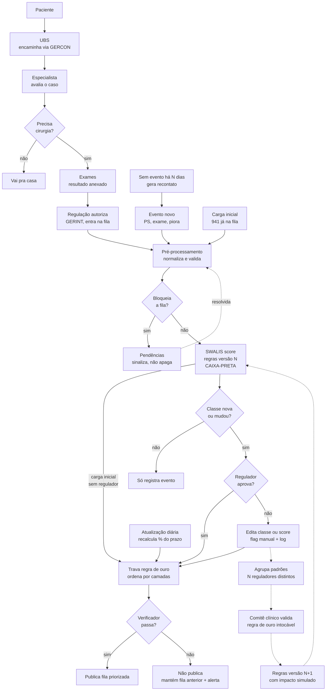

# Fluxo do sistema — HealthPrior (Time Branco)

> **Status:** v1 · 24/10/2026 · definido em sessão de design do time
> **Escopo deste documento:** o fluxo *high level* do sistema (do paciente entrar na fila até a fila priorizada ser publicada) e o ciclo de aprendizado.
> **Fora deste documento:** o funcionamento interno do **SWALIS score** (mapeamento sinal → classe, prazos, % do prazo consumido). Ele é tratado aqui como uma **caixa-preta com contrato definido** (seção 7.6) e terá documentação própria.

---

## 0. Como usar este documento (AI-first development)

Este arquivo é a **fonte de verdade** do comportamento do sistema. Agentes de IA e pessoas devem:

1. **Ler as seções 2 (escopo), 9 (invariantes) e 10 (decisões) antes de escrever código.** Invariantes nunca podem ser violados; decisões só mudam com acordo do time.
2. **Referenciar os IDs** (`C-xx` componentes, `I-xx` invariantes, `D-xx` decisões, `Q-xx` questões abertas) em commits, PRs e prompts. Ex.: `feat(C-05): normaliza CID sem ponto`.
3. **Não inventar regra clínica.** Se algo não está aqui, é uma questão aberta: registre em `Q-xx` em vez de decidir em código.
4. **Validar sempre com o verificador oficial** (`verificar_fila_priorizada.py`) antes de considerar qualquer mudança na ordenação concluída.
5. **Atualizar este documento** no mesmo PR que muda o comportamento descrito aqui.

---

## 1. Contexto do desafio

- **Evento:** 9ª Hackatona de Engenharia de Software 2026 · Desafio 1 · Fin-X · PUCRS · Hospital São Lucas (HSL).
- **Problema:** priorizar a fila de cirurgias eletivas do SUS. A fila atual é ordenada por prioridade manual (ruidosa, quase nunca revisada) e data de entrada.
- **Dados:** 100% sintéticos. Data de referência **23/10/2026**.
  - `fila_cirurgica.csv` — 941 solicitações
  - `eventos_clinicos.csv` — ~1.500 eventos durante a espera
  - `procedimentos.csv` — 23 procedimentos
  - `swalis.csv` — classes A1–D com prazo máximo (15, 21, 60, 180, 360 dias)
  - `dicionario_dados.md` — descrição de cada coluna
  - `data/referencias/CID10CSV/` — tabelas públicas CID-10 (DATASUS)
- **Entregável obrigatório:** `fila_priorizada.csv` com colunas `solicitacao_id`, `posicao`, `justificativa` (pode ter colunas extras), validado por `verificar_fila_priorizada.py`.
- **Regra de ouro (eliminatória):** nenhum paciente com neoplasia maligna (CID iniciado por `C`) pode ficar abaixo de um paciente sem urgência clínica. **Usar o CID, não a flag.**
- **Critérios de avaliação:** originalidade 30% · valor para quem decide 30% · segurança e explicabilidade 20% · execução técnica 20%.
- **Fora do escopo do desafio:** agenda de sala, preparo pré-operatório, cancelamentos. Campos de pré-op são opcionais e não avaliados.

---

## 2. Escopo deste sistema

| Dentro | Fora |
|---|---|
| Ingestão da carga inicial e de eventos novos | Cálculo interno do SWALIS (documento próprio) |
| Pré-processamento: normalização, validação, inconsistências | Agenda de sala, capacidade, OR scheduling |
| Caixa de pendências administrativas | Preparo pré-operatório (HbA1c, ASA, exames) como critério de ordem |
| Decisão do regulador (aprovar / editar) com log | Integração real com GERCON / GERINT |
| Trava da regra de ouro e verificação antes de publicar | Diagnóstico ou decisão clínica automática |
| Atualização diária da fila | Treino de modelo de ML |
| Ciclo de aprendizado a partir das justificativas | |

---

## 3. Glossário

| Termo | Significado |
|---|---|
| **Solicitação** | Um pedido de cirurgia na fila (`solicitacao_id`). Um paciente pode ter mais de uma. |
| **Evento** | Algo que aconteceu durante a espera: biópsia, PS, internação, imagem, reavaliação, contato telefônico, falta, HbA1c. |
| **SWALIS** | Método de priorização por classes de urgência (A1, A2, B, C, D), cada uma com prazo máximo. |
| **Classe** | A1–D. Diz quanto tempo a doença tolera esperar. Mudar a classe é **julgamento clínico**. |
| **% do prazo consumido** | `dias_esperando / prazo_da_classe`. Ordena dentro da classe. Muda **sozinho** todo dia. |
| **Score** | Valor numérico usado para ordenar (derivado da classe + tempo). Calculado pelo SWALIS (caixa-preta). |
| **Regulador** | Médico regulador que confirma ou altera classes. Persona principal da tela clínica (ver `Q-01`). |
| **Camada** | Bloco de ordenação imposto pela trava: 1 = oncológicos, 2 = urgentes não oncológicos, 3 = demais. |
| **Pendência** | Problema de dado/administrativo que precisa de ação humana (não clínica). |
| **Override** | Classe ou score definido manualmente pelo regulador, sobrepondo o do sistema. |
| **Versão de regras** | Versão da tabela de regras do SWALIS usada num cálculo (`regras v7`). |
| **GERCON / GERINT** | Sistemas de regulação de Porto Alegre (consultas / internações). Só contexto. |
| **ACS** | Agente Comunitário de Saúde. |

---

## 4. Personas

| Persona | O que faz no sistema | Tela |
|---|---|---|
| **Regulador** (médico) | Confirma ou edita classe/score de pacientes cuja classe é nova ou mudou. | Inbox clínico |
| **Equipe administrativa / call center** | Resolve pendências: confirma desistência, funde duplicatas, recontata. | Caixa de pendências |
| **Comitê clínico** | Aprova ou rejeita propostas de novas regras do SWALIS. | Tela de propostas |
| **Equipe técnica** | Recebe alerta quando a fila não passa no verificador. | Alerta / CI |
| **Gestor** | Consome a fila priorizada e indicadores. | Dashboard (fora deste doc) |

---

## 5. Visão geral do fluxo

**Leitura rápida:**
- **Cinza (contexto):** tudo antes da regulação autorizar. O sistema não implementa isso; serve para o pitch.
- **Entradas:** entrada nova, evento novo, recontato, carga inicial, atualização diária.
- **Caminho clínico:** só chega ao regulador quando a **classe** muda. Tempo passando não gera trabalho humano.
- **Portões de segurança:** pré-processamento (dados) → trava (ordem) → verificador (publicação).
- **Tracejado:** ciclo de aprendizado, roda offline (ex.: mensal), nunca altera regras sem comitê.

---

## 6. Fluxos por tipo de entrada

| Entrada | Pré-proc. | SWALIS | Regulador | Trava + verificador | Frequência |
|---|---|---|---|---|---|
| **Carga inicial** (941) | sim, em lote | sim | **não** (`D-01`) | sim | uma vez |
| **Entrada nova** (paciente autorizado) | sim | sim | sim (classe nova) | sim | por evento |
| **Evento novo** | sim | sim | só se a classe mudar (`D-02`) | sim | por evento |
| **Recontato** (sem evento há N dias) | sim | sim | só se a classe mudar | sim | gerado pelo job diário |
| **Atualização diária** | não | recalcula % do prazo | não | sim | 1x/dia |

---

## 7. Componentes

Cada componente tem: responsabilidade, entradas, saídas, regras e critérios de aceite (CA).

### C-01 · Contexto pré-sistema
Paciente → UBS (GERCON) → Especialista → Precisa cirurgia? → Exames → Regulação autoriza (GERINT).
- **Não implementar.** Representado só no pitch e nesta documentação.
- Observação: quem decide a indicação cirúrgica é o especialista; a UBS só encaminha.

### C-02 · Entrada: carga inicial
- **Responsabilidade:** carregar as 941 solicitações e ~1.500 eventos do dataset.
- **Regras:**
  - Passa pelo pré-processamento (C-05) como qualquer entrada.
  - **Não passa pelo regulador** (`D-01`). A classe calculada fica marcada `classe_status = sugerida_nao_confirmada`.
  - A confirmação acontece naturalmente no primeiro evento que mude a classe do paciente.
  - **Passa pela trava** (C-11) e pelo verificador (C-12). É ela que corrige, por exemplo, os oncológicos hoje com prioridade "baixa".
- **CA:** após a carga, `fila_priorizada.csv` existe e passa no verificador; todo paciente tem `classe_status`.

### C-03 · Entrada: evento novo
- **Responsabilidade:** receber um evento (PS, internação, biópsia, imagem, reavaliação, contato, falta, HbA1c) e disparar o recálculo daquela solicitação.
- **Regras:** passa por C-05; se a classe resultante for igual à atual, apenas registra (C-08).
- **CA:** um evento sem mudança de classe não gera item no inbox do regulador.

### C-04 · Entrada: recontato ("sem evento")
- **Responsabilidade:** evitar que **silêncio seja confundido com estabilidade**.
- **Motivação:** 326 solicitações não têm nenhum evento. Ausência de evento pode ser estabilidade, atendimento em outro serviço, barreira de acesso (distância/TFD), telefone desatualizado, cirurgia feita fora, desistência ou óbito.
- **Regras:**
  - O job diário (C-13) detecta solicitações sem evento há **N dias** e gera um evento sintético `recontato_pendente`.
  - Ação: call center liga ou ACS visita. O retorno vira evento comum (`relata_piora` → gatilho; `informou_cirurgia_outro_servico` / `desistiu` → pendência; `nao_atendeu` repetido → contato perdido).
  - Referência para N: NHS revisa a cada 6 meses ou ao estourar o prazo da classe, o que vier antes (`Q-04`).
- **CA:** nenhum paciente fica mais de N dias sem evento ou recontato registrado.

### C-05 · Pré-processamento
- **Responsabilidade:** normalizar, padronizar e validar **todas** as entradas com **o mesmo código** (lote e evento a evento).
- **Saídas:** dado limpo → C-06/C-07; problema → C-06 (pendência).
- **Toda correção automática é registrada** (`correcoes_log`): campo, valor original, valor novo, regra aplicada.

Os problemas se dividem em três tipos:

#### Tipo 1 — sistema corrige sozinho (não gera pendência)

| Regra | Problema | Exemplo real no dataset | Ação |
|---|---|---|---|
| PRE-01 | CID sem padrão | `K42.9` e `K429` (mesmo código); 32 CIDs sem ponto: `K801`, `D440`, `E041`, `C169` | Normaliza: maiúsculas, sem ponto para comparação (`cid_norm`), mantém original |
| PRE-02 | Nome com grafia variada | PAC-00087: "Jurema Quadros Weber" / "JUREMA QUADROS WEBER" | Normaliza caixa/acentos para comparação; mantém original |
| PRE-03 | Município inconsistente | "Porto Alegre" (347), "PORTO ALEGRE" (12), "porto alegre" (8); idem Canoas, Viamão, Pelotas, Osório… | Mapeia para nome oficial (IBGE) |
| PRE-04 | Prioridade com grafia variada | `baixa`/`Baixa`, `media`/`Média`, `alta`/`Alta` | Normaliza para `alta`/`media`/`baixa` |
| PRE-05 | Flag oncológica contradiz o CID | SOL-2025-00149 (C61, flag `nao`, prioridade baixa, 510 dias); SOL-2026-00583 (hérnia K40.9 com flag `sim`); SOL-2025-00196 (neoplasia **benigna** com flag `sim`) | Recalcula `oncologico = cid_norm começa com C`; guarda a flag original |
| PRE-06 | Flags de diabetes/piora desatualizadas | 67 pacientes com PS/internação recente e `flag_piora_clinica = nao` | Recalcula a partir de eventos/texto; guarda original. Piora por evento: D-18/D-19. Diabetes: fica para a PRE-13 (alerta, US-05) |
| PRE-07 | Evento duplicado | EVT-000050 e EVT-000051: mesma falta, mesma solicitação (SOL-2023-00083), mesmo dia | Mantém um; marca o outro como duplicado |
| PRE-08 | Evento anterior à entrada na fila | 155 eventos. Ex.: SOL-2023-00017 com 2 PS em dez/2022, entrou em mar/2023 | Marca `historico = true`: **não conta como piora** durante a espera |

#### Tipo 2 — precisa de humano, mas o paciente **segue na fila** (gera pendência não bloqueante + alerta)

| Regra | Problema | Exemplo real | Ação |
|---|---|---|---|
| PRE-10 | Contato perdido | SOL-2025-00053: "NAO ATENDE. NUMERO NAO EXISTE." 39 pacientes com ≥2 tentativas sem resposta | Pendência "atualizar contato"; **não pune** (pode ser barreira de acesso) |
| PRE-11 | Sem telefone | SOL-2026-00059: "PCT NAO POSSUI TELEFONE FIXO. CONTATO VIA ACS." (28 casos) | Pendência "contato via ACS" |
| PRE-12 | Câncer escondido (biópsia positiva com CID não C) | SOL-2026-00757 (D37.4 com biópsia positiva); 23 casos | Segue o fluxo de eventos (proposta de subir classe) + pendência "corrigir CID" |
| PRE-13 | Diabetes fora do cadastro | SOL-2026-00444: "HbA1c 9,4%… Diabetes nao consta no cadastro, atualizar." | Pendência "atualizar cadastro"; **não altera prioridade** |
| PRE-14 | Justificativa sem conteúdo | SOL-2026-00932: "Solicito cirurgia."; SOL-2025-00375: "Conforme laudo anexo." | Alerta "informação insuficiente para classificar" |
| PRE-15 | Campo vazio | 11 sem `prioridade_regulacao`; 38 sem dor EVA; 26 sem ASA; 20 sem distância | SWALIS usa o que existe; alerta de completude |

#### Tipo 3 — **bloqueia**: sai da fila priorizada até alguém confirmar (pendência bloqueante)

| Regra | Problema | Exemplo real | Ação |
|---|---|---|---|
| PRE-20 | Solicitação duplicada (mesmo `paciente_id` + `procedimento_id`) | 22 grupos / 44 linhas. PAC-00151: SOL-2025-00290 (`K429`) e SOL-2025-00348 (`K42.9`). PAC-00307 (C73): SOL-2026-00743 (ago) e SOL-2026-01014 (out) | Suspende a mais recente; proposta de fusão **mantendo a data de entrada mais antiga** (favorece o paciente) e unindo os eventos |
| PRE-21 | Operou em outro serviço | SOL-2023-00054: "realizou a cirurgia em outro servico (Hospital de Clinicas) em 09/09/2026"; 5 pelo call center | Suspende até confirmação |
| PRE-22 | Operou pelo convênio | SOL-2025-00453: "Familiar informa que paciente operou pelo convenio." | Suspende até confirmação |
| PRE-23 | Desistência | SOL-2024-00076: "PCT DESISTIU DO PROCEDIMENTO. SOLICITA RETIRADA DA FILA."; 13 pelo call center | Suspende até confirmação |
| PRE-24 | Evento órfão (solicitação fora da fila) | 9 casos. EVT-000287 → SOL-2023-00941: "Registro de solicitacao removida da fila." | Evento não é aplicado; pendência para verificar ID |
| PRE-25 | Fontes contraditórias | SOL-2026-00305: call center diz "desistiu"; observação diz "operou pelo convenio" | Pendência com **as duas evidências lado a lado** |

> Exceção de segurança: **um oncológico nunca é suspenso automaticamente** por PRE-21/22/23 sem confirmação humana registrada (ver `I-02`).

- **CA:**
  - Rodar o pré-processamento duas vezes sobre o mesmo dado produz o mesmo resultado (idempotente).
  - Nenhuma linha é apagada; toda suspensão tem motivo codificado.
  - O mesmo módulo é usado pela carga inicial e pelos eventos.

### C-06 · Pendências
- **Responsabilidade:** lista de trabalho administrativa (call center / regulação), separada da tela clínica.
- **Cada item tem:** `pendencia_id`, `solicitacao_id`, `tipo` (regra PRE-xx), `bloqueante` (sim/não), evidência (trecho/evento de origem), ação sugerida ("ligar para confirmar desistência", "fundir com SOL-…"), `status` (`aberta` / `resolvida` / `descartada`), `resolvido_por`, `resolvido_em`, `resolucao`.
- **Saídas da resolução:**
  - volta ao pré-processamento e segue o fluxo normal; ou
  - sai da fila **com motivo registrado** (nunca deletada).
- **Entrega do hackathon:** suspensos ficam **fora** do `fila_priorizada.csv` e são listados no `DECISOES.md` com o motivo.
- **Por quê:** Inglaterra (14% das saídas sem motivo registrado), Portugal e Nova Zelândia (remoções administrativas maquiando indicadores). Regra de design: **sinalizar, não apagar**.
- **Achado para o pitch:** não há **nenhum óbito** registrado numa fila com mediana de 268 dias. Isso é um sinal de que a informação não está chegando.

### C-07 · SWALIS score (caixa-preta)
Documentado à parte. Este fluxo só depende do **contrato**:

| Entrada | Saída |
|---|---|
| Solicitação limpa + eventos limpos (exceto `historico = true`) + tabela de regras (versão N) | `classe_sistema` (A1–D), `prazo_dias`, `pct_prazo_consumido`, `score_sistema`, `motivos[]` (sinais que levaram à classe, com evidência citada), `versao_regras` |

- Deve ser **determinístico** para a mesma entrada e mesma versão de regras.
- Deve devolver **motivos explicáveis** (vão para a coluna `justificativa`).
- Se usar LLM para extrair sinais do texto: o LLM **extrai e cita o trecho**, não decide a classe.

### C-08 · Classe nova ou mudou?
- **Sim** (primeira classe de uma entrada nova, ou classe diferente da atual) → C-09 (regulador).
- **Não** → "Só registra evento": o evento fica gravado e a ordenação é refeita pela atualização diária (C-13). Não gera trabalho humano (`D-02`).
- **Motivo:** classe é julgamento clínico (humano); posição na fila é aritmética (automática). Sem esse filtro, ~1.500 eventos + reordenação diária virariam um inbox impossível, e o regulador aprovaria sem ler.
- **Exceção:** carga inicial pula este passo (`D-01`).

### C-09 · Regulador aprova?
- **Tela:** inbox com a proposta, a classe atual, a classe sugerida, os motivos e a evidência citada (evento, trecho do texto).
- **Sim** → C-11 (trava). `classe_status = confirmada`.
- **Não** → C-10 (edição).
- Se o paciente já tinha override manual, o inbox avisa: "você editou este paciente em DD/MM" (não apaga o override em silêncio).
- **CA:** toda decisão gera registro no log de decisões (seção 8.4).

### C-10 · Edição manual (classe ou score)
- O regulador edita a **classe** ou o **score**, **não a posição** (`D-03`).
  - Posição é relativa e muda todo dia; fixar posição congelaria o paciente ou seria desfeito no dia seguinte.
  - Na UI pode ser "arrastar para cima", desde que por trás vire score.
  - Score editado **continua envelhecendo** normalmente.
- **Obrigatório:** `motivo_codificado` (lista fechada) + `justificativa` (texto livre).
- **Flag:** `editado_manualmente = sim`, com `editado_por`, `editado_em`.
- Pode **manter** a classe do sistema recusando a sugestão (também com motivo): é sinal para o aprendizado.
- **Bloqueio na tela:** a edição é recusada na hora se rebaixar um oncológico para baixo de um paciente sem urgência, com a mensagem "oncológico não pode ficar abaixo de paciente sem urgência" (`I-01`).
- **Ordem efetiva:** usa `score_medico` se existir, senão `score_sistema`.

### C-11 · Trava da regra de ouro
- **Responsabilidade:** impor a ordem por **camadas**. Não rejeita: **corrige**.
  1. **Camada 1 — oncológicos** (`cid_norm` começa com `C`), ordenados entre si pelo score efetivo.
  2. **Camada 2 — urgentes não oncológicos** (biópsia positiva, PS/internação durante a espera, progressão, reavaliação com piora, CID de complicação, sinais de alarme no texto).
  3. **Camada 3 — demais**, pelo score efetivo.
- O score decide a ordem **dentro** da camada; nenhuma camada invade a de cima.
- Recebe de: regulador (sim), edição manual, carga inicial, atualização diária.
- **Exemplo de por que existe:** um câncer de pele classe B com 15 dias (25% do prazo) ficaria abaixo de uma hérnia classe D com 400 dias (111%) se só o score ordenasse, violando a regra de ouro.
- **Fila atual viola a regra:** pelo verificador, o primeiro paciente "sem urgência" está na posição 12, acima dos 177 oncológicos.
- A definição de "sem urgência" do verificador oficial é conservadora: CID não oncológico, dor EVA ≤ 3, limitação nenhuma/leve, sem CID de obstrução/instabilidade, sem PS/internação/biópsia positiva/progressão/reavaliação com piora, sem palavras de alarme na justificativa. A camada 2 deve ser **pelo menos** tão abrangente quanto o complemento disso.

### C-12 · Verificador e publicação
- Antes de publicar, roda `verificar_fila_priorizada.py`.
- **Passa** → publica `fila_priorizada.csv`.
- **Falha** → **não publica**, mantém a fila anterior e alerta a equipe técnica (não o regulador). Publicar uma fila errada é pior do que manter a de ontem.
- No hackathon: rodar o verificador no **CI a cada commit**.
- Conferir que colunas extras no CSV não quebram o verificador (colunas obrigatórias: `solicitacao_id`, `posicao`, `justificativa`).

### C-13 · Atualização diária
- Job 1x/dia:
  1. recalcula `pct_prazo_consumido` e o score efetivo de todos (inclusive overrides, que envelhecem);
  2. aplica eventos "só registrados" do dia;
  3. detecta pacientes sem evento há N dias → gera recontato (C-04);
  4. passa pela trava (C-11) e pelo verificador (C-12).
- Não passa pelo regulador. Eventos que **mudam a classe** não esperam o job: vão direto ao regulador (importante para A1).

### C-14 · Ciclo de aprendizado (offline)
Não é retreino de ML. O que muda é a **tabela de regras** do SWALIS (sinal + procedimento → classe), nunca a fórmula de tempo/prazo.

| Nó | O que faz |
|---|---|
| **Origem** | Cada edição/recusa do regulador grava no log: paciente, procedimento, regulador, classe sugerida, classe decidida, `motivo_codificado`, texto livre, data. Os dois sentidos contam (subir e manter). |
| **Agrupa padrões** | Job periódico agrupa por `procedimento + motivo + mudança de classe`. Motivos "outro" são agrupados por LLM. Vira **proposta de regra** só se passar nos filtros (estilo Waze, valores provisórios `Q-05`): **volume** ≥ 5 casos; **independência** ≥ 3 reguladores distintos; **validade** últimos 90 dias (expira); **consistência** ≥ 80% na mesma direção. |
| **Comitê clínico valida** | Tela de propostas: regra, casos de origem com justificativas, impacto simulado. Aprova, rejeita ou ajusta. Propostas que rebaixariam oncológico são **bloqueadas antes** de chegar ao comitê (`I-01`). Atende à CFM 2.454/2026 (comitê institucional). |
| **Regras versão N+1** | Antes de publicar: roda a fila inteira com a tabela nova sem aplicar (shadow run) e mostra o diff ("12 subiriam de C para B; nenhum oncológico afetado"). Versionada; reversível. |
| **Volta ao SWALIS** | Nova versão entra em vigor; pacientes que mudam de classe passam pelo fluxo normal (C-08 → C-09). Cada paciente continua com decisão humana. |

**Exemplo:** 7 edições em 2 meses, de 4 reguladores, todas "colecistectomia + PS recorrente: C → B" → proposta "colecistectomia + ≥2 PS em 90 dias → B" → comitê aprova → v8 → 12 pacientes vão ao inbox como mudança de classe.

**Implementação no hackathon:** regras em JSON versionado no repo; log em CSV/tabela; agrupamento com `pandas.groupby` + filtros; LLM só para motivos "outro"; tela de comitê com cards aprovar/rejeitar; ~30 justificativas sintéticas pré-carregadas formando 2–3 padrões para a demo.

---

## 8. Modelo de dados (adições ao dataset)

### 8.1 Solicitação — colunas novas

| Coluna | Tipo | Descrição |
|---|---|---|
| `cid_norm` | texto | CID maiúsculo sem ponto (PRE-01) |
| `oncologico` | bool | `cid_norm` começa com `C` (PRE-05) |
| `piora_recalculada` | bool | Piora por evento durante a espera, ou flag original "sim" (PRE-06, D-18/D-19) |
| `municipio_norm` | texto | Nome oficial (PRE-03) |
| `prioridade_norm` | texto | `alta`/`media`/`baixa`/vazio (PRE-04) |
| `status_fila` | enum | `ativa`, `suspensa`, `removida` |
| `motivo_status` | texto | Regra PRE-xx / resolução da pendência |
| `classe_sistema` | enum | A1–D (saída do SWALIS) |
| `score_sistema` | número | Saída do SWALIS |
| `pct_prazo_consumido` | número | Saída do SWALIS |
| `motivos_sistema` | json | Sinais e evidências |
| `versao_regras` | texto | Versão da tabela usada |
| `classe_status` | enum | `sugerida_nao_confirmada`, `confirmada` |
| `classe_medico` | enum/vazio | Override |
| `score_medico` | número/vazio | Override |
| `editado_manualmente` | bool | Flag |
| `editado_por`, `editado_em` | texto, data | Auditoria |
| `motivo_codificado`, `justificativa_medico` | texto | Alimentam o aprendizado |
| `camada` | 1/2/3 | Definida pela trava |
| `score_efetivo` | número | `score_medico` se existir, senão `score_sistema` |
| `ultimo_evento_em` | data | Para o recontato (C-04) |

### 8.2 Evento — colunas novas
`duplicado_de` (evento_id ou vazio), `historico` (bool, PRE-08), `orfao` (bool, PRE-24), `processado_em`, `mudou_classe` (bool).

### 8.3 Pendência
`pendencia_id`, `solicitacao_id`, `regra` (PRE-xx), `bloqueante`, `evidencias` (json), `acao_sugerida`, `status`, `aberta_em`, `resolvido_por`, `resolvido_em`, `resolucao`.

### 8.4 Log de decisões do regulador
`decisao_id`, `solicitacao_id`, `procedimento_id`, `regulador_id`, `data`, `classe_sugerida`, `classe_decidida`, `score_decidido`, `acao` (`aprovou`/`editou`/`manteve`), `motivo_codificado`, `justificativa`, `versao_regras`.

### 8.5 Proposta de regra e versão
- `proposta_regra`: `proposta_id`, `procedimento_id`, `sinal`, `classe_de`, `classe_para`, `casos[]`, `n_reguladores`, `consistencia`, `impacto_simulado`, `status`, `decidido_por`, `decidido_em`.
- `versao_regras`: `versao`, `publicada_em`, `aprovada_por`, `diff`, `anterior`.

### 8.6 Saída: `fila_priorizada.csv`
Obrigatórias: `solicitacao_id`, `posicao`, `justificativa`. Recomendadas: `camada`, `classe`, `pct_prazo_consumido`, `editado_manualmente`, `versao_regras`.
`justificativa` deve ser legível: ex. "Camada 1 (oncológico C18.7). Classe A2: biópsia positiva em 30/01/2023. 1.318 dias, 6.276% do prazo."

### 8.7 Motivos codificados (lista inicial, provisória)
`ps_recorrente`, `internacao_relacionada`, `progressao_imagem`, `piora_funcional`, `dor_intensa`, `biopsia_positiva`, `sinal_alarme_texto`, `sugestao_exagerada`, `dado_desatualizado`, `outro`.

---

## 9. Invariantes (nunca violar)

| ID | Invariante |
|---|---|
| **I-01** | **Regra de ouro:** nenhum paciente com `cid_norm` iniciado por `C` fica abaixo de paciente sem urgência clínica. Vale para score, edição manual, carga inicial, atualização diária e regras aprendidas. |
| **I-02** | Oncológico nunca é rebaixado nem suspenso automaticamente. Só por decisão humana registrada (e nunca rebaixado abaixo de não urgente). |
| **I-03** | Nada é apagado. Toda saída da fila tem motivo, autor e data. |
| **I-04** | Mudança de classe sempre tem decisão humana (exceto carga inicial, marcada como não confirmada). |
| **I-05** | O LLM extrai e cita; nunca decide classe nem altera CID sozinho. |
| **I-06** | Regras do SWALIS só mudam via comitê, com versão e impacto simulado. |
| **I-07** | Uma fila que não passa no verificador não é publicada. |
| **I-08** | Ausência de eventos não é tratada como estabilidade (gera recontato). |
| **I-09** | Usar o CID, não a flag, para decidir oncológico. |
| **I-10** | Toda correção automática fica registrada com valor original. |

---

## 10. Decisões tomadas

| ID | Decisão | Motivo |
|---|---|---|
| D-01 | Carga inicial é um fluxo à parte e **não** passa pelo regulador. Classe fica `sugerida_nao_confirmada`. | Inviável revisar 941 casos; confirmação acontece no primeiro evento que mudar a classe. |
| D-02 | Evento que não muda a classe só é registrado; não dispara reordenação nem regulador. | A atualização diária já reordena. Evita fadiga de alertas. |
| D-03 | Regulador edita **classe ou score**, não posição; flag `editado_manualmente` + colunas de override. | Posição é relativa e muda todo dia; score editado convive com o job diário e com a trava. |
| D-04 | Pré-processamento único para carga inicial e eventos. | Mesmas regras para lote e fluxo contínuo. |
| D-05 | Inconsistências são sinalizadas, nunca apagadas; bloqueantes suspendem até confirmação. | Auditabilidade; lições de Inglaterra, Portugal e Nova Zelândia. |
| D-06 | Regra de ouro implementada como **camadas** (trava), não como peso no score. | Restrição dura; nenhum número supera. |
| D-07 | Verificador oficial é portão de publicação; falha mantém a fila anterior. | Violação é eliminatória. |
| D-08 | Ciclo de aprendizado propõe regras; comitê aprova; versões com impacto simulado. | Originalidade com controle humano (CFM 2.454/2026, LGPD art. 20). |
| D-09 | Detalhes internos do SWALIS ficam fora deste documento. | Separação de responsabilidades. |
| D-10 | Duplicatas são fundidas mantendo a data de entrada mais antiga. | Favorece o paciente. |

---

## 11. Questões em aberto

| ID | Questão | Para quem |
|---|---|---|
| Q-01 | Quem aprova: médico regulador ou cirurgião? Muda a tela. | Mentores Fin-X/HSL |
| Q-02 | Desistência / "operou fora": sai na hora ou fica suspenso até confirmação? (proposta atual: suspenso) | Mentores |
| Q-03 | Duplicata é fundida automaticamente ou exige confirmação? (proposta atual: exige) | Mentores |
| Q-04 | Valor de N para o recontato (proposta: 180 dias ou estouro do prazo da classe). | Time + mentores |
| Q-05 | Limiares do aprendizado (≥5 casos, ≥3 reguladores, 90 dias, ≥80%). | Time |
| Q-06 | Override expira? (proposta: até a próxima mudança de classe ou data de revisão) | Time |
| Q-07 | Como tratar oncológicos de baixo risco (CBC de pele C44, próstata ISUP 1) **dentro** da camada 1? ("decisão difícil" do pitch) | Mentores |
| Q-08 | Biópsia positiva com CID benigno: sobe automaticamente para camada 1 ou só via regulador + correção de CID? | Mentores |
| Q-09 | Distância/TFD deve pesar na prioridade ou só ser monitorada? (proposta: só monitorada) | Mentores |
| Q-10 | Idade 80+ como desempate dentro da camada? | Mentores |

---

## 12. Números do dataset (referência rápida)

- 941 solicitações; mediana **268 dias** na fila; 353 > 1 ano; 152 > 2 anos; máximo 1.550 dias.
- **89,6%** nunca tiveram a prioridade revisada.
- **177** oncológicos pelo CID; 34 com prioridade "baixa"; 174 já passaram de 21 dias.
- **104** com PS/internação nos últimos 180 dias; 67 com `flag_piora_clinica = nao`.
- **23** com biópsia positiva e CID não C.
- **326** sem nenhum evento.
- Distância: mediana 251 dias (até 30 km) vs 377 dias (> 300 km).
- Sujeira: 22 grupos de duplicatas (44 linhas), 9 eventos órfãos, 155 eventos anteriores à entrada, 44 flags oncológicas erradas, 13 desistências, 5 operados fora, 62 grafias de município, 11 prioridades vazias, 0 óbitos registrados.

**Pacientes para a demo:**
- **SOL-2023-00010** — adenocarcinoma de sigmoide (C18.7), 1.318 dias, prioridade baixa, flag oncológica "nao". Hoje na posição 606.
- **SOL-2026-00637** — colelitíase com colangite há 3 semanas, só no texto, flag de piora "nao".
- **SOL-2023-00060** — colelitíase, 2 idas ao PS citadas só no texto, prioridade baixa, 1.109 dias.
- **SOL-2026-00757** — D37.4 com biópsia positiva ("câncer escondido").
- **SOL-2026-00305** — fontes contraditórias (desistiu × operou pelo convênio).

---

## 13. Guia para agentes de IA

**Ordem sugerida de implementação**
1. C-05 pré-processamento (tipo 1) + testes com os exemplos reais da seção 7.
2. C-11 trava + C-12 verificador no CI. Com SWALIS *stub* (ex.: ordenar por dias em fila), a fila já deve passar no verificador.
3. C-02 carga inicial gerando `fila_priorizada.csv`.
4. C-06 pendências (tipos 2 e 3) + lista no `DECISOES.md`.
5. Integração com o SWALIS real (contrato C-07).
6. C-08/C-09/C-10 inbox do regulador e edição com flag.
7. C-13 job diário + C-04 recontato.
8. C-14 ciclo de aprendizado (demo com dados sintéticos).

**Regras para quem gera código**
- Não apagar linhas de entrada. Use `status_fila`.
- Não usar `flag_oncologico` para decisão; usar `cid_norm`.
- Não usar eventos com `historico = true` como piora.
- Não usar contagem de eventos como prioridade (viés de acesso); pesar por gravidade.
- Não colocar HbA1c, ASA, distância ou faltas no score (são alertas/auditoria).
- Toda função de transformação deve ser pura e testável; toda correção, logada.
- Rodar `python src/verificar_fila_priorizada.py fila_priorizada.csv` antes de abrir PR.

**Prompt base para tarefas**
> "Implemente `<C-xx>` conforme `docs/fluxo-sistema.md`. Respeite `I-01` a `I-10`. Não decida nada listado em `Q-xx`; deixe configurável. Inclua testes com os exemplos reais da seção 7."
