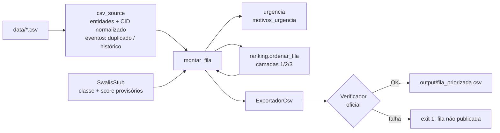

# US-08 · Trava da regra de ouro — registro de implementação

> **Branch:** `feat/US-08-trava-regra-de-ouro` · **Data:** 24/10/2026
> **Componentes:** C-11 (trava), parte de C-12 (verificador) · **Histórias:** US-08 completa; US-09 e US-10 em versão provisória (D-26)
> **Status:** implementado e validado (62 testes passando; verificador oficial **OK** sobre as 941 solicitações)
> **Revisão 1 (D-27):** a camada 2 passou a conter só sinais clínicos; dor e limitação viraram sintomas (ver §3 e §4).

---

## 1. O que foi entregue

| Entrega | Arquivo | Camada |
|---|---|---|
| Sinais de urgência (camada 2) | `backend/app/domain/urgencia.py` | domain |
| Trava por camadas | `backend/app/domain/ranking.py` | domain |
| Montagem da fila + justificativa | `backend/app/application/montar_fila.py` | application |
| Leitura do dataset sem banco | `backend/app/infrastructure/csv_source.py` | infrastructure |
| Comando `gerar-fila-csv` | `backend/app/cli.py` | composição |
| Testes | `tests/domain/test_ranking.py`, `tests/domain/test_urgencia.py`, `tests/application/test_montar_fila.py`, `tests/infrastructure/test_csv_source.py` | — |

Como rodar (dentro de `backend/`):
```bash
python -m app.cli gerar-fila-csv   # gera output/fila_priorizada.csv e roda o verificador oficial
pytest -q
```

---

## 2. Como funciona



### 2.1 Camadas (`domain/ranking.py`)
> **Revisto por D-112:** as camadas 1 e 2 agora formam um bloco só, ordenado pelo score (`definir_bloco`); a chave virou **(bloco ↑, score ↓, entrada ↑, id ↑)** e o teste de propriedade garante só que a camada 3 não invade o bloco. A inclusão "camada 2 ⊆ urgente para o verificador" é travada por `tests/infrastructure/test_trava_dataset.py`. O texto abaixo é o desenho original (D-06).

- `definir_camada`: oncológico (CID `C*`) → **1**; senão urgente → **2**; senão **3**.
- `ordenar_fila`: chave **(camada ↑, score efetivo ↓, data de entrada ↑, solicitacao_id ↑)**. Posições `1..n` sem buracos. `ValueError` se houver `solicitacao_id` repetido. Não altera a entrada.
- Garantia testada por propriedade (300 itens aleatórios): nenhum oncológico depois de não oncológico; nenhuma camada 2 depois de camada 3.

### 2.2 Urgência (`domain/urgencia.py`)
Duas funções separadas (D-27):
- `motivos_urgencia(sinais)` → **sinais clínicos, definem a camada 2**.
- `motivos_sintomas(sinais)` → **sintomas, não definem camada**: só entram na justificativa (a intensidade é critério do SWALIS para a classe).

`motivos_urgencia` devolve, nesta ordem:

| Código | Condição | Origem |
|---|---|---|
| `cid_complicacao` | CID em `CID_URGENTE` (K40.0/K40.3, K42.0, K43.0, K80.0, I20.0, N13.2, I83.2) | verificador |
| `evento_piora` | PS, internação, biópsia positiva, imagem com progressão ou reavaliação com piora **durante a espera**, não duplicado | verificador + D-23 |
| `biopsia_positiva` | biópsia positiva **em qualquer data** | D-24 |
| `sinal_alarme` | palavra de alarme na `justificativa_clinica` (mesma regex do verificador) | verificador |


`motivos_sintomas` devolve `dor` (EVA > 3) e `limitacao` (moderada/grave).

`is_urgente = bool(motivos_urgencia(...))`. Os códigos viram texto na justificativa.

> Antes da revisão (D-22), `dor` e `limitacao` também definiam a camada 2, espelhando o complemento de "sem urgência" do verificador. Ver §3.

### 2.3 Fila e justificativa (`application/montar_fila.py`)
- Considera só `status_fila = ativa`.
- `score_efetivo = score_medico` se existir, senão `score_sistema`; classe exibida idem (prepara US-14).
- Justificativa: `"Camada N: <motivo>. [Sintomas: ...] Classe X (prazo P dias, regras V); D dias em fila, Y% do prazo."` (+ "Editado manualmente pelo regulador." quando houver override).
- A aplicação não importa infraestrutura: o scorer chega por parâmetro (Protocol).

### 2.4 Leitura do dataset (`infrastructure/csv_source.py`)
- Lê com `dtype=str` e converte à mão (vazio → `None`; `justificativa_clinica`/`observacoes` → `""`).
- `cid_norm`, `oncologico` (pelo **CID**, I-09) e `prioridade_norm` preenchidos.
- Eventos: duplicados marcados por (solicitação, data, tipo, resultado, descrição), mantendo o menor `evento_id` (PRE-07); `historico=True` se anteriores à entrada (PRE-08); órfãos ficam fora (PRE-24, ainda sem pendência).
- Nada é escrito nos CSVs oficiais.

---

## 3. Decisões de implementação

| ID | Decisão | Motivo | Quem |
|---|---|---|---|
| D-22 | ~~Camada 2 = complemento exato de "sem urgência" do verificador~~ — **revista por D-27** | Mais seguro em relação à regra oficial | Time (João) |
| D-23 | Eventos de piora só contam se forem durante a espera e não duplicados | Coerente com PRE-07/PRE-08; histórico motivou a indicação | Time (João) |
| D-24 | Câncer escondido (biópsia positiva com CID não C) vai para a camada 2 com alerta "revisar CID". A biópsia positiva conta **em qualquer data** | Sem a exceção, D-23 apagaria esses casos (a biópsia costuma ser anterior à entrada). Mantém "usar o CID" para a camada 1 (Q-08 segue aberta) | Time (João) + lead |
| D-25 | Desempate: score ↓, entrada mais antiga ↑, `solicitacao_id` ↑ | Ordem determinística e reprodutível; 80+ aguarda Q-10 | Lead |
| D-26 | Geração provisória do CSV direto do dataset (sem banco) com SWALIS stub | Garantir a entrega das 14h sem depender da US-01 | Time (João) |
| D-27 | Camada 2 = só sinais clínicos; dor e limitação viram sintomas (justificativa + SWALIS) | Ver §3.1 | Time (João), recomendação do lead |

### 3.1 Por que a D-27 revisou a D-22

Com a D-22, a camada 2 tinha 526 pacientes (56% da fila). Abrindo por motivo:

| Por que entrava na camada 2 | Pacientes |
|---|---|
| Só dor e/ou limitação | **320** (61%) — 119 só dor, 69 só limitação, 132 ambos |
| Algum sinal clínico | **206** (39%) |

Exemplos do grupo "só sintoma": SOL-2026-00702 (varizes, dor 5, sem úlcera), SOL-2024-00030 (varizes, dor 6), SOL-2026-00059 (hemorroida grau III, dor 7). Eles competiam de igual para igual, dentro da camada 2, com colangite, PS e progressão em imagem; a camada deixava de destacar quem **piorou**.

Argumentos da decisão:
1. **Regra de ouro intacta:** ela só exige oncológico acima de "sem urgência", o que a camada 1 já garante independentemente da camada 2.
2. **Papéis separados:** a camada é override duro para "o risco de esperar aumentou"; intensidade de sintoma é o que a classe SWALIS (B/C/D) mede. Usar os dois duplicava o critério.
3. **Dor é autorrelatada e ruidosa**; não deve pesar como um evento documentado.
4. **Pitch:** "a camada 2 são os 206 pacientes que pioraram durante a espera" é verificável.

Alternativa descartada: 4 camadas (onco / clínico / sintomático / demais) — mais difícil de explicar e invade o papel do SWALIS.

Decisões menores (subagentes, revisadas pelo lead):
- `ordenar_fila` cria novos objetos e não muta a entrada.
- Percentual na justificativa formatado com `:g` (ex.: `120%`, `6276.2%`).
- `tem_sinal_alarme` passou a devolver sempre `bool` (antes podia devolver `None` com texto vazio) — correção do lead.
- O comando novo usa o adaptador `VerificadorOficial` (o mesmo que o caso de uso `GerarFila` usará), e não um subprocess duplicado.

---

## 4. Resultado sobre o dataset real (SWALIS stub)

| Indicador | Valor |
|---|---|
| Verificador oficial | **OK — regra de ouro respeitada e formato válido** |
| Indicador | D-22 (antes) | **D-27 (atual)** |
|---|---|---|
| Camadas 1 · 2 · 3 | 177 · 526 · 238 | **177 · 206 · 558** |
| Posição mediana dos oncológicos (fila original: 287) | 89 | **89** |
| Oncológicos no primeiro terço | 100% | **100%** |
| PS/internação nos últimos 180 dias na 1ª metade | 50% | **100%** |
| "Sem urgência" (definição do verificador) no último terço | 100% | **70%** |

O último indicador caiu porque a camada 3 agora mistura pacientes "sem urgência" com sintomáticos, ordenados pelo score do SWALIS stub. É **informativo** (não é erro do verificador) e tende a melhorar com o SWALIS real, que coloca sintomáticos em classes mais altas.

Exemplos:
- **SOL-2023-00010** (adenocarcinoma, 1.318 dias, prioridade "baixa") → **posição 1**.
- **SOL-2026-00637** (colangite só no texto) → camada 2, posição **255** (antes 454): alarme + evento; dor e limitação como sintomas.
- **SOL-2026-00757** (D37.4 com biópsia positiva) → camada 2, posição **283** (antes 530), com "revisar CID".
- **SOL-2023-00060** (2 idas ao PS citadas só no texto) → camada 3, posição **532** (antes 744).
- **SOL-2026-00702** (varizes, dor 5) → camada 3, posição 906, com "Sintomas: dor EVA 5".

---

## 5. Limitações e achados (entrada para o SWALIS e próximas histórias)

1. **A ordem dentro das camadas ainda é do SWALIS stub** (prioridade manual + % do prazo). Sintomáticos na camada 3 só sobem quando o SWALIS real usar dor/limitação na classe (só trocar em `api/deps.py` e `cli.py`).
2. ~~Camada 2 grande (526, 56%)~~ — **resolvido pela D-27** (206).
3. **Sinais só no texto livre** (ex.: "2 idas ao PS" da SOL-2023-00060) não são capturados: a regex do verificador não inclui "PS". É o caso de uso para extração por LLM com citação (I-05), no SWALIS.
4. **Pendências não implementadas** (US-04/05): duplicatas, desistências e órfãos ainda entram/saem sem pendência registrada. Todas as 941 solicitações estão no CSV.
5. A fila não é persistida (sem banco): o "não publicar" (I-07) é o `exit 1` do comando.

## 6. Próximos passos
- US-01 (carga no banco) → `GerarFila.executar` reutiliza `montar_fila` e `ordenar_fila` sem mudança.
- SWALIS real → trocar `SwalisStub` em `api/deps.py` e `cli.py`.
- US-04 → passar a excluir suspensos (já respeitado por `montar_fila` via `status_fila`).
- Decidir com os mentores: Q-08 (câncer escondido na camada 1?) e Q-10 (80+ como desempate).
