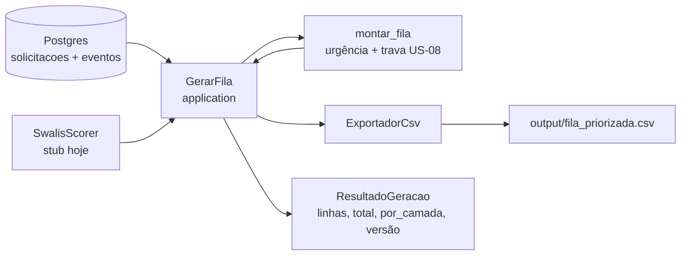

# US-09 · Gerar `fila_priorizada.csv` a partir do banco — registro de implementação

> **Branch:** `feat/US-09-gerar-fila-banco` · **Data:** 24/10/2026 · **Componentes:** C-11 (consumo), C-12 (preparação)
> **Status:** implementado. Testes: 103 passando; 23 de banco pulam sem Postgres (rodam com `docker compose up -d`).
> **Próximo passo:** US-10 (`feat/US-10-verificador-portao`, empilhada sobre esta) adiciona verificador, publicação e CI.

## 1. O que foi entregue

| Entrega | Arquivo |
|---|---|
| Caso de uso `GerarFila` real (banco → fila → CSV) | `backend/app/application/gerar_fila.py` |
| `LinhaFila` movida para o domínio | `backend/app/domain/models.py` (reexportada em `montar_fila.py`) |
| Porta `FilaRepository` com `LinhaFila` | `backend/app/domain/ports.py` |
| `SqlEventoRepository.listar_todos` / `listar_por_solicitacao` | `backend/app/infrastructure/repositories.py` |
| Comando `python -m app.cli gerar-fila` (via banco) | `backend/app/cli.py` |
| `GET /fila/export` real (CSV) | `backend/app/api/routers/fila.py`, `backend/app/api/deps.py` |
| Testes | `tests/application/test_gerar_fila.py`, `tests/infrastructure/test_gerar_fila_banco.py` |

Como rodar:
```bash
docker compose up -d                       # Postgres
cd backend
python -m app.cli carga                    # US-01 + US-02
python -m app.cli gerar-fila               # gera output/fila_priorizada.csv a partir do banco
curl -o fila.csv localhost:8000/fila/export
```

## 2. Como funciona



- Lista **só ativas** (suspensas/removidas pela futura US-04 já ficam de fora sozinhas).
- Agrupa eventos por solicitação; eventos de solicitações fora da lista são ignorados.
- **Reaproveita `montar_fila`** (US-08): nenhuma regra duplicada; o CSV via banco e o provisório (`gerar-fila-csv`) usam a mesma lógica.
- Retorna `ResultadoGeracao(linhas, caminho_csv, total, versao_regras, por_camada)` — a US-10 usa as `linhas` para publicar.

## 3. Decisões

| ID | Decisão | Motivo |
|---|---|---|
| D-28 | Separar **gerar** (US-09, `GerarFila`) de **publicar** (US-10, `PublicarFila`). `GerarFila` não conhece verificador nem repositório da fila | Responsabilidade única; cada parte testável; a US-10 não reescreve a US-09 |
| D-29 | `LinhaFila` mora no **domínio** e a porta `FilaRepository` usa `list[LinhaFila]` | O repositório da fila publicada precisa da justificativa, e o domínio não pode importar a aplicação |
| D-30 | Nesta US, `GET /fila/export` **gera a fila na hora** a partir do banco | Entregar o endpoint já funcional; na US-10 ele passa a servir só a fila **publicada** (que passou no verificador) |

Decisões menores (subagente, revisadas pelo lead):
- `SqlEventoRepository.listar_todos` ordena por (solicitação, data, evento_id); `listar_por_solicitacao` por (data, evento_id). Implementados aqui porque a US-09 precisa — **atenção ao merge com a US-03**, que também pode mexer em eventos.
- `ResultadoGeracao.versao_regras` vem do scorer; `por_camada` ordenado por camada.
- A CLI usa `SwalisStub` (como `gerar-fila-csv`); troca para o SWALIS real só na composição.

## 4. Limitações
- O teste de ponta a ponta com banco (`test_gerar_fila_banco.py`) pula sem Postgres; roda localmente com `docker compose up -d` e no CI (US-10).
- Ainda sem verificador nem persistência: a fila gerada aqui **não é "publicada"** (US-10).
