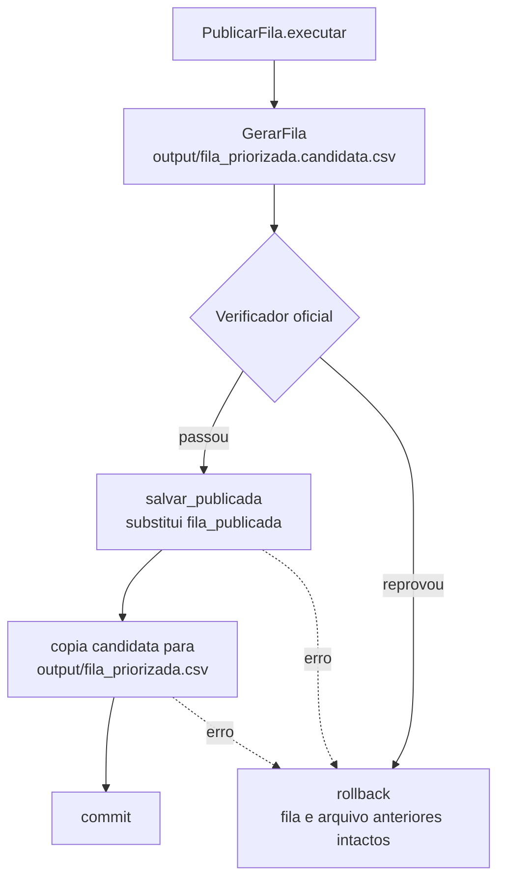

# US-10 · Verificador como portão de publicação — registro de implementação

> **Branch:** `feat/US-10-verificador-portao` (empilhada sobre `feat/US-09-gerar-fila-banco`) · **Data:** 24/10/2026
> **Componente:** C-12 · **Invariante:** I-07 (fila que não passa no verificador não é publicada)
> **Status:** implementado. Testes: 112 passando; 24 de banco pulam sem Postgres (rodam com Docker e no CI).

## 1. O que foi entregue

| Entrega | Arquivo |
|---|---|
| Caso de uso `PublicarFila` (gerar → verificar → publicar) | `backend/app/application/publicar_fila.py` |
| Caso de uso `ExportarFilaPublicada` | `backend/app/application/publicar_fila.py` |
| `SqlFilaRepository` (`salvar_publicada`, `obter_publicada`, `publicada_em`) | `backend/app/infrastructure/repositories.py` |
| Colunas novas em `fila_publicada` (classe, % do prazo, dias, editado) | `backend/app/infrastructure/tables.py` |
| Erro `FILA_NAO_PUBLICADA` (409) | `backend/app/domain/errors.py` |
| `POST /admin/publicar-fila` (200 publicada / 422 reprovada) | `backend/app/api/routers/admin.py`, `schemas.PublicacaoOut` |
| `GET /fila/export` serve **só a fila publicada** | `backend/app/api/routers/fila.py` |
| `python -m app.cli gerar-fila` agora publica (exit 1 se reprovar) | `backend/app/cli.py` |
| CI no GitHub Actions | `.github/workflows/ci.yml` |
| Testes | `tests/application/test_publicar_fila.py`, `tests/api/test_fila_export.py`, `tests/infrastructure/test_publicar_fila_banco.py` |

Como rodar:
```bash
docker compose down -v && docker compose up -d   # a tabela fila_publicada mudou (D-16: sem migrations)
cd backend
python -m app.cli carga
python -m app.cli gerar-fila      # gera, verifica e publica; exit 1 se o verificador reprovar
curl -X POST localhost:8000/admin/publicar-fila
curl -o fila.csv localhost:8000/fila/export      # 409 se nada publicado
```

## 2. Como funciona



- A fila publicada vive no banco (`fila_publicada`) e no arquivo `output/fila_priorizada.csv`. Os dois só mudam juntos e só se o verificador aprovar.
- `GET /fila/export` lê da tabela publicada (não gera nada); sem publicação → `409 FILA_NAO_PUBLICADA`.
- CI (`.github/workflows/ci.yml`): Postgres 16 como service → `pytest` → `init-db` → `carga` → `gerar-fila`. **Se o verificador reprovar, o CI falha.** O CSV publicado sobe como artefato `fila_priorizada`.

## 3. Decisões

| ID | Decisão | Motivo |
|---|---|---|
| D-31 | Gerar primeiro um **arquivo candidato** (`fila_priorizada.candidata.csv`) e só promovê-lo a `fila_priorizada.csv` se o verificador aprovar | O arquivo bom anterior nunca é sobrescrito por um reprovado (I-07) |
| D-32 | Publicar = **substituir a fila inteira** em `fila_publicada` dentro da unidade de trabalho; reprovação ou erro → rollback | Fila publicada sempre consistente; a anterior continua valendo |
| D-33 | Ordem: salvar no banco → copiar o arquivo → commit | Se a cópia falhar, o banco é desfeito e arquivo e banco seguem iguais. (Risco residual: commit falhar depois da cópia — raro) |
| D-34 | `GET /fila/export` serve **só a fila publicada** (substitui D-30); 409 se não houver | Ninguém baixa uma fila que não passou no verificador |
| D-35 | `POST /admin/publicar-fila` responde 200 (publicada) ou **422** (reprovada) com o mesmo corpo | Front/demo sabem o resultado sem ler logs |
| D-36 | CI roda pytest **com Postgres** e depois a publicação real; falha se o verificador reprovar | Garante a regra de ouro a cada push/PR |
| D-37 | O relógio da publicação é injetado (`relogio`) | Aplicação sem `datetime.now()`; testes determinísticos |

Decisões menores (subagente, revisadas pelo lead):
- Novas colunas em `fila_publicada`: `classe`, `pct_prazo_consumido`, `dias_em_fila` (obrigatórias) e `editado_manualmente` (padrão False). **Exige recriar o banco** (`docker compose down -v`), conforme D-16.
- `publicada_em()` = maior `publicada_em` da tabela (todas as linhas têm o mesmo).
- `ExportarFilaPublicada` grava `output/fila_publicada.csv`; o download se chama `fila_priorizada.csv`.
- Correção do lead: a cópia do arquivo foi movida para **antes** do commit (D-33); o subagente fazia depois.

## 4. Limitações
- Não rodei o CI nem os testes de banco no ambiente do lead (sem Postgres); rodam no Docker local e no GitHub Actions.
- Banner "fila não publicada" no front (P2) não implementado.
- O CI sobe o Postgres e carrega o dataset a cada execução (~1 min); aceitável para o hackathon.
