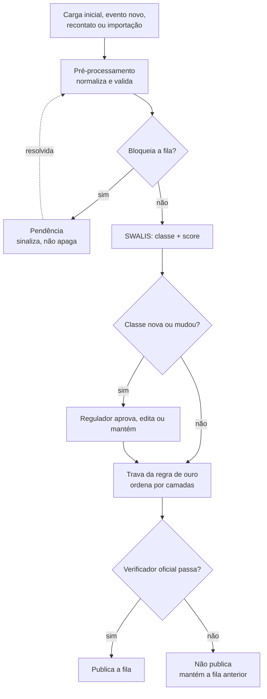

# Fluxo do sistema

Resumo de [`docs/fluxo-sistema.md`](../fluxo-sistema.md), que é a fonte completa (componentes `C-xx`, regras `PRE-xx`).

## Personas
| Persona | O que faz | Tela |
|---|---|---|
| **Regulador** (médico) | Confirma ou edita classe/score de quem teve a classe criada ou alterada | Inbox |
| **Equipe administrativa** | Resolve pendências: confirma desistência, funde duplicatas, recontata | Pendências |
| **Comitê clínico** | Aprova ou rejeita propostas de novas regras do SWALIS | Propostas |
| **Equipe técnica** | Recebe alerta quando a fila não passa no verificador | Alerta / CI |
| **Gestor** | Consome a fila e as métricas | Fila (e `GET /metricas/comparacao`, ainda sem tela) |

## Caminho de um paciente

## Os três portões de segurança
1. **Dados (pré-processamento):** normaliza, valida e transforma problemas em pendências. Uma pendência bloqueante
   suspende a solicitação da fila sem apagá-la.
2. **Ordem (trava):** aplica as camadas e garante a regra de ouro.
3. **Publicação (verificador):** o `src/verificar_fila_priorizada.py` oficial roda antes de publicar. Se reprovar,
   a fila anterior continua valendo e a decisão do usuário não se perde.

## Entradas
- **Carga inicial:** 941 solicitações, classe sugerida e marcada como não confirmada.
- **Evento novo:** pronto-socorro, internação, biópsia, exame de imagem, reavaliação. Pode subir a classe.
- **Atualização diária:** recalcula o % do prazo consumido sozinho; tempo passando **não** gera trabalho humano.
- **Recontato (REC-01):** ausência de eventos não é estabilidade; abre pendência para contatar o paciente.
- **Importação de CSV:** pacientes novos pela tela ou pela API ([Importação de CSV](Importacao-de-CSV.md)).

## Fora do escopo
Agenda de sala, preparo pré-operatório como critério de ordem, integração real com GERCON/GERINT e decisão
clínica automática.
